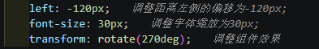

# What's That (WST) For Visual Studio Code

> [English README](README.md)

新手学习、写代码效率实在低下，为解决现状，WST插件横空出世！

本插件做的事情十分简单：

读取工作区根目录下 `.WST` 文件夹里的“代码 ↔ 说明”对照表，把中文说明显示在 **代码补全候选项的右侧** 和 **代码行的右侧**。

## 功能

侧边栏（活动栏上的 W 图标）里有一个「WST 控制台」窗口：

- **刷新** 按钮 —— 重新扫描工作区根目录下的 `.WST` 文件夹。
- **启用 WST** —— 总开关，关闭后下面两个功能都不生效。
- **启用候选注释** —— 代码补全弹窗里，为命中的候选项在右侧显示说明文本。
- **启用代码行注释** —— 在代码行右侧以内联装饰显示对应的说明文本。

点击刷新后：若工作区根目录下没有 `.WST` 文件夹，WST 无动作（控制台显示“未找到 .WST 文件夹”）；若有，则读取其中的 txt 文件。所有语言文件会一次性全部加载。

## .WST 文件夹格式

在 **工作区根目录** 下创建 `.WST` 文件夹，里面放置 **以语言名为文件名** 的 txt 文件，例如 `css.txt`、`csharp.txt`、`javascript.txt`、`python.txt`。文件名（不含 `.txt`）应与 VSCode 的语言 ID 一致（注意是 `csharp`，不是 `cshap`）。

(可以前往本项目的.WST查看示例)

每个 txt 文件：

- **单数行（1、3、5…）写代码**
- **双数行（2、4、6…）写文本说明**

代码行支持几种形式：

1. 普通单词：`font-size`
2. 带占位符：`font-size: [$1];`
3. 多个占位符：`border-top: [$1] [$2] [$3]`

> **补全候选**只收录**无占位符**的普通单词条目（如 `font-size`）；带 `[$n]` 占位符的条目是整行模板，仅用于**代码行注释**，不会出现在候选项中。

文本行里可以：

- 用 `[$1]`、`[$2]`… 引用代码行中对应占位符，做 **代码行注释** 时会被替换成实际值；
- 用 `{solid:单直线,doble:双直线,...}` 这种 `键:说明` 列表作为取值说明（原样显示）。

## 如何使用 / 运行

1. 用 VSCode 打开本目录（`whats-that`）。
2. 按 `F5`（或运行「运行 WST 扩展」配置），会打开一个扩展开发宿主窗口。
3. 在那个窗口里打开一个含 `.WST` 文件夹的工作区，例如直接打开 `whats-that` 目录本身（它已内置示例 `.WST`）。
4. 打开一个 `css` 文件，输入 `font-size` 触发补全即可看到右侧说明；输入 `border-top: 1px solid red` 可看到行尾的中文说明。

## 配置

在 `设置 → 扩展 → What's That (WST)` 中，或在侧边栏勾选：

- `wst.enabled`：总开关
- `wst.enableCandidateComments`：候选注释
- `wst.enableLineComments`：代码行注释

## 本地化

扩展界面支持 **英文（默认）** 和 **简体中文**（`zh-cn`），跟随 VSCode 显示语言。

## 实现说明

- **候选注释**：WST 自己注册了一个补全提供器，只把 `.WST` 文件中**无占位符**的普通单词条目作为补全候选项给出，`detail`（候选项右侧）显示对应的文本说明；带 `[$n]` 的整行模板条目不参与补全。VSCode 的公开 API 无法修改其他扩展返回的候选项，因此“给已有候选项加注释”是通过 WST 自己提供这些候选项来实现的。
- **代码行注释**：通过 `createTextEditorDecorationType` 的 `after` 内联装饰，把匹配到的说明显示在行尾。

## 脚注

脚本量小，我直接用DeepSeek Harness完成，如果没有特殊需求，我应该不会更新这个插件

如果有需求，或者有bug，欢迎上报，或者创建一个复刻，完成这个项目！

## 许可

[Apache License 2.0](LICENSE)
